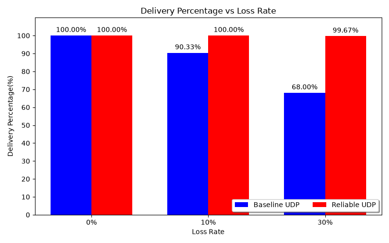

# CSE 3461 — Messaging Project

A Python networking project covering TCP broadcast messaging, direct messaging,
and a standalone reliable UDP chat. All source files, documentation, and saved
benchmark results live in the repository root.

## Modules

| Module | Feature | Status |
| --- | --- | --- |
| 1 | TCP broadcast to connected clients other than the sender | Implemented in `server.py` |
| 2 | Direct messaging using `@username` | Routing is present, but `feature2()` is still a TODO |
| 3 | Two-way reliable UDP chat under simulated packet loss | Implemented in `chat.py` and `reliable_udp.py` |

Module 3 runs independently of the TCP server and client.

## Requirements

Use Python 3.10 or newer. The chat applications and benchmark use only Python's
standard library. Matplotlib is needed only to regenerate the chart; the optional
plotting environment is recorded in `requirements.txt`.

```sh
python3 -m pip install -r requirements.txt
```

Run the commands below from the repository root.

## Module 3: live chat showcase

Open two terminals and start both peers before sending messages.

Terminal A:

```sh
python3 chat.py --port 5000 --peer-port 5001 --loss .5 --seed 1
```

Terminal B:

```sh
python3 chat.py --port 5001 --peer-port 5000 --loss .5 --seed 1
```

1. Send two messages from A. With this seed and loss setting, the first message
   succeeds immediately and the second message's first attempt is dropped.
2. Point out `ACK received; attempts=2` for the second message. The sender retries
   after the default 0.3-second timeout, and the receiver displays it once.
3. Reply from B to demonstrate communication in both directions.
4. Enter `/stats` on both peers to inspect delivery, retransmission, and drop
   counters. Counters appear after the corresponding events occur.
5. Enter `/quit` to exit.

### What Module 3 adds

- Application-layer ACKs confirm acceptance into the receiver's in-memory queue.
- Stop-and-wait retransmission retries messages when an ACK does not arrive.
- Session IDs and sequence numbers suppress duplicate delivery; duplicates are
  still acknowledged in case an earlier ACK was lost.
- Configurable, seeded DATA and ACK loss makes demonstrations reproducible.
- Per-message feedback reports confirmation, attempts, and ACK completion time.
- `/stats` exposes transport counters.
- `--baseline` sends once without ACKs or retries for comparison.

ACKs confirm receipt by the application, not that a person has read the message.
Delivery can remain unconfirmed when retries are exhausted, even if a message
arrived but its ACKs were lost. Loss is simulated after socket reception; these
experiments do not measure physical Wi-Fi loss.

### Chat options

| Option | Default | Purpose |
| --- | --- | --- |
| `--bind` | `127.0.0.1` | Local IPv4 address |
| `--port` | Required | Local UDP port |
| `--peer` | `127.0.0.1` | Other peer's address |
| `--peer-port` | Required | Other peer's UDP port |
| `--loss` | `0.2` | Probability of dropping incoming DATA |
| `--ack-loss` | `0` | Probability of dropping incoming ACKs |
| `--seed` | `1` | Reproducible loss seed |
| `--timeout` | `0.3` | Seconds to wait per attempt |
| `--retries` | `5` | Additional attempts after the initial send |
| `--baseline` | Off | Send once without reliability |

To demonstrate duplicate suppression, restart both peers with `--loss 0
--ack-loss .5 --seed 1` and send several messages. Inspect
`duplicates_suppressed` on the receiver and `ack_simulated_drops` on the sender.
For baseline comparison, restart both peers with the original demo commands plus
`--baseline`; the second message from A is dropped without a retry.

For two computers on the same network, use `--bind 0.0.0.0` and set `--peer` to the
other computer's LAN IPv4 address. Allow the selected UDP ports through the
firewall. The local demo requires no server.

## Modules 1 and 2: TCP application

The server listens on TCP port 12033. Before running the client, set `SERVER_IP`
in `client.py` to `127.0.0.1` for a same-computer demo, or to the server's LAN IPv4
address for separate computers. The existing `0.0.0.0` client value is a bind
address and is not a portable destination address.

Start the server:

```sh
python3 server.py
```

Start each client in a separate terminal:

```sh
python3 client.py
```

Enter a unique username, then send a message to broadcast to other clients.
Messages beginning with `@username` reach the Module 2 placeholder and are not
yet delivered. The TCP prototype also has unfinished disconnect handling; the
Module 3 showcase uses the independent UDP chat.

## Benchmark and chart

Compare send-once UDP with reliable UDP across the default loss rates of 0%,
10%, and 30%, using three seeds and 100 messages per mode per seed:

```sh
python3 benchmark.py
python3 plot_results.py
```

The benchmark writes `trials.csv`, `summary.csv`, and `environment.txt` beside the
scripts. Plotting reads `summary.csv`, writes `plot.png`, and displays the chart.
These commands overwrite the saved results. Both tools default to the project
root, so they do not create a results subfolder. Optional `--output` (benchmark)
and `--results-dir` (plotter) can select a different location.

For a short demonstration:

```sh
python3 benchmark.py --messages 10 --runs 1 --loss 0 .5 --timeout .05
python3 plot_results.py
```

Metrics include delivery percentage, retransmissions, ACK completion time, and
delivered messages per second. Timing includes application pacing and a fixed
50 ms drain period; it is not a network capacity measurement. Saved results
retain the environment and parameters of their original run.



## Files

| File | Purpose |
| --- | --- |
| `server.py` | TCP server and Module 1/2 handlers |
| `client.py` | TCP terminal client |
| `chat.py` | Module 3 two-way terminal chat |
| `reliable_udp.py` | Shared UDP transport, ACKs, retries, and duplicate suppression |
| `benchmark.py` | Paired baseline/reliable UDP experiments |
| `plot_results.py` | Delivery comparison chart |
| `requirements.txt` | Optional plotting dependencies |
| `trials.csv` | Saved per-trial benchmark measurements |
| `summary.csv` | Saved averages by mode and loss rate |
| `environment.txt` | Original benchmark environment and parameters |
| `plot.png` | Saved delivery comparison chart |
| `.gitignore` | Excludes Python caches and local environment files |
